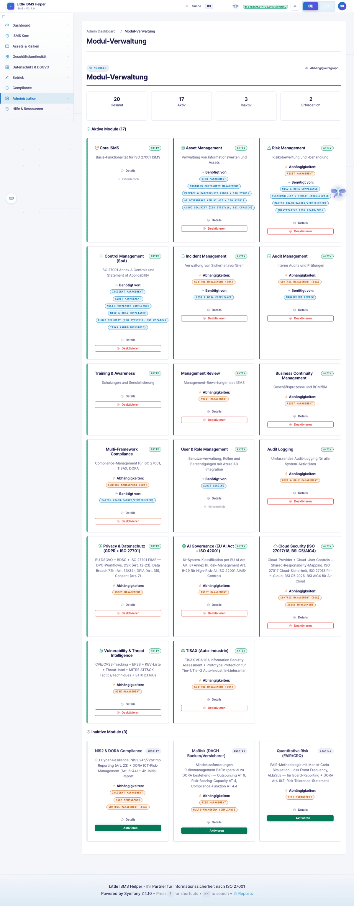

# Admin Panel User Guide

**Target Audience:** System Administrators

## Table of Contents

1. [Introduction](#introduction)
2. [Access Requirements](#access-requirements)
3. [Admin Features Overview](#admin-features-overview)
4. [Module Management](#module-management)
5. [Compliance Framework Management](#compliance-framework-management)
6. [License Management](#license-management)
7. [User & Access Management](#user--access-management)
8. [System Monitoring](#system-monitoring)
9. [Data Management](#data-management)
10. [Best Practices](#best-practices)
11. [Troubleshooting](#troubleshooting)

---

## Introduction

The Little ISMS Helper Admin Panel provides comprehensive system administration capabilities for managing modules, compliance frameworks, licenses, users, system health, and data backups.

### Key Features

- **Module Management**: Activate/deactivate functional modules with dependency tracking
- **Compliance Management**: Load and manage compliance frameworks (ISO 27001, NIST, etc.)
- **License Management**: Track third-party licenses and ensure compliance
- **User Management**: Manage users, roles, permissions, and MFA tokens
- **System Monitoring**: Monitor system health, performance, and errors
- **Data Management**: Create backups, export/import data

---

## Access Requirements

### Prerequisites

- User account with `ROLE_ADMIN` permission
- Authenticated session
- Modern web browser (Chrome, Firefox, Edge, Safari)

### Accessing the Admin Panel

Admin features are available through the main navigation sidebar when logged in with admin privileges:

```
Navigation > [Admin Section]
- Users
- Module Management
- Compliance Management
- License Management
```

---

## Admin Features Overview

### Navigation Structure

The admin panel integrates seamlessly into the main application navigation:

| Menu Item | Route | Description |
|-----------|-------|-------------|
| Module Management | `/admin/modules` | Manage system modules |
| Compliance Management | `/admin/compliance` | Manage compliance frameworks |
| License Management | `/admin/licensing` | View license information |
| User Management | `/admin/users` | Manage users and roles |
| System Monitoring | `/admin/monitoring/health` | System health dashboard |
| Data Management | `/admin/data/backup` | Backup and data operations |

---

## Module Management

### Overview

The Module Management interface allows administrators to activate/deactivate functional modules and manage their dependencies.



### Module Statistics

- **Total Modules**: All available modules in the system
- **Active Modules**: Currently enabled modules
- **Inactive Modules**: Disabled modules
- **Required Modules**: Core modules that cannot be deactivated

### Activating a Module

1. Navigate to **Module Management** (`/admin/modules`)
2. Locate the desired module in the "Inactive Modules" section
3. Review module dependencies (if any)
4. Click **Activate** button
5. System will automatically activate required dependencies
6. Confirmation message will appear

**Note**: Some modules may require sample data import after activation.

### Deactivating a Module

1. Navigate to **Module Management** (`/admin/modules`)
2. Locate the module in the "Active Modules" section
3. Click **Deactivate** button (disabled for required modules)
4. Confirm deactivation
5. System will prevent deactivation if other modules depend on it

### Module Details

Click **Details** on any module to view:
- Module description and entities
- Dependency graph (required and dependent modules)
- Available sample data for import
- Export functionality for module data

### Dependency Graph

View the complete module dependency structure:
1. Click **Dependency Graph** button
2. Review table showing:
   - Module status (Active/Inactive)
   - Module type (Required/Optional)
   - Dependencies (modules it needs)
   - Dependents (modules that need it)

---

## Compliance Framework Management

### Overview

Manage compliance frameworks including ISO 27001, NIST CSF, BSI IT-Grundschutz, and custom frameworks.

### Framework Statistics

- **Total Available**: All loadable frameworks
- **Loaded**: Currently active frameworks
- **Not Loaded**: Available but not activated
- **Mandatory Missing**: Required frameworks not yet loaded

### Loading a Framework

1. Navigate to **Compliance Management** (`/admin/compliance`)
2. Locate framework in the available frameworks list
3. Review framework details:
   - Version
   - Industry (General, Healthcare, Finance, etc.)
   - Regulatory body
   - Mandatory status
4. Click **Load Framework** button
5. Wait for loading confirmation
6. Framework requirements will be imported into database

Framework catalogues and global mappings are shared by every organisation of the instance. With more than one
organisation, only `ROLE_SUPER_ADMIN` loads a framework (or the starter pack) or changes global mappings
(`GlobalCatalogueVoter::WRITE`); with a single organisation the admin may.

### Deleting a Framework

**Warning**: Deleting a framework removes all associated requirements and mappings for every organisation.
Only `ROLE_SUPER_ADMIN` may delete (`ADMIN_GLOBAL_OP`).

1. Locate loaded framework
2. Click **Delete Framework** button
3. Confirm deletion in dialog
4. Framework and all related data will be removed

### Viewing Compliance Statistics

1. Navigate to **Compliance Statistics** (`/admin/compliance/statistics`)
2. Review compliance metrics:
   - Total requirements per framework
   - Assessed requirements count
   - Compliant requirements count
   - Compliance percentage
   - Progress bar visualization

**Compliance Calculation** (this page only):
- **Assessed**: Requirements with at least one mapped control
- **Compliant**: Requirements with at least one mapped control in status "implemented"
- **Compliance Rate**: (Compliant / Total) × 100%

The fulfilment shown on requirements, dashboards and reports is derived per organisation instead, see
[ERFUELLUNG_AUS_DATEN.md](user-guide/ERFUELLUNG_AUS_DATEN.md).

---

## License Management

### Overview

Track and manage third-party open-source licenses used in the project.

### License Overview

Navigate to **License Management** (`/admin/licensing`) to view:
- Project license information
- Third-party dependency notices (NOTICE.md)
- License compliance status

### Generating License Reports

1. Navigate to **License Report** or **License Summary**
2. If report doesn't exist, click **Generate Report**
3. System will analyze composer dependencies
4. Report includes:
   - License type classification (Allowed, Restricted, Copyleft)
   - Package counts per license
   - Compliance recommendations

### License Categories

| Category | Description | Examples |
|----------|-------------|----------|
| **Allowed** | Permissive licenses | MIT, Apache-2.0, BSD |
| **Restricted** | Conditional use | MPL-2.0, EPL-2.0 |
| **Copyleft** | Requires source distribution | GPL, LGPL |
| **Not Allowed** | Incompatible with project | AGPL (depends on policy) |
| **Unknown** | Unrecognized licenses | Custom, proprietary |

---

## User & Access Management

### User Management

Comprehensive user administration features:

#### User Operations

1. **Create User**
   - Set username, email, password
   - Assign roles
   - Configure MFA settings

2. **Edit User**
   - Update user information
   - Modify role assignments
   - Enable/disable account

3. **Bulk Actions**
   - Select multiple users
   - Bulk enable/disable
   - Bulk role assignment
   - Bulk delete

4. **CSV Import/Export**
   - Export user list to CSV
   - Import users from CSV template

#### User Activity Dashboard

Track user activity including:
- Last login times
- Failed login attempts
- Active sessions
- Action history

#### MFA Token Management

Manage Multi-Factor Authentication tokens:
- View all MFA tokens per user
- Token types: TOTP, WebAuthn, SMS, backup codes
- Reset MFA tokens for locked-out users
- Monitor token usage and last use

#### User Impersonation

Impersonate users for troubleshooting (needs `ROLE_ALLOWED_TO_SWITCH`, which only `ROLE_SUPER_ADMIN` has; a
super admin is never a target, and nobody may become a user with roles they do not reach, `SwitchUserVoter`):
1. Navigate to user details
2. Click **Impersonate** button
3. Session switches to target user
4. Exit impersonation using `/_switch_user` link

**Security Note**: All impersonation actions are logged in audit log.

### Role Management

Manage role hierarchy and permissions:

#### Role Operations

1. **Create Role**
   - Define role name
   - Assign permissions
   - Set role hierarchy

2. **Role Templates**
   (`/admin/roles/templates`): Auditor, Risk Manager, Compliance Officer, Incident Manager, Asset Manager,
   Read-only. Persona roles (CISO, ISB, DPO, …, Leitung) are system roles assigned on the user form; see
   [PERSONA_DASHBOARDS.md](user-guide/PERSONA_DASHBOARDS.md).

3. **Role Comparison**
   - Compare permissions across roles
   - Identify permission gaps
   - Optimize role structure

### Permission Management

View and manage system permissions:
- Grouped by category (user, risk, asset, etc.)
- Permission details showing usage in roles
- Permission statistics

### Session Management

Monitor active user sessions:
- Session tracking based on login events
- User activity timeline
- Session termination (requires database session storage). "Sitzung beenden" signs the browser out on its next
  request (`TerminatedSessionSubscriber`); the same holds for sessions closed by the limit of five
  concurrent sessions. Rows the idle cleanup marks `timeout` do not sign anybody out — PHP's own session lifetime
  handles idleness; the last activity is refreshed at most every five minutes.

---

## System Monitoring

### Health Dashboard

Access at `/admin/monitoring/health`

#### Health Checks

| Check | Description | Thresholds |
|-------|-------------|------------|
| **Database** | Connection status and response time | < 100ms: Good, < 500ms: Warning, >= 500ms: Critical |
| **Disk Space** | Available disk space | > 20%: Good, > 10%: Warning, <= 10%: Critical |
| **PHP** | Version and required extensions | PHP 8.4+, All extensions loaded |
| **Symfony** | Framework version | 7.4+ |
| **Cache** | Cache directory writable | Writable: Good |
| **Logs** | Log directory writable | Writable: Good |

#### Performance Monitoring

View performance metrics:
- Request processing time averages
- Memory usage statistics
- Cache hit/miss ratios
- Database query performance

#### Error Log Viewer

Access recent errors at `/admin/monitoring/errors`:
- Log level filtering (error, critical, warning)
- Log source filtering (app, request, security)
- Timestamp and message details
- Stack trace viewing

#### Audit Log Integration

The audit log (`/admin/audit-log`, menu entry for admins only, `ROLE_ADMIN`) shows:
- User actions and changes
- Timestamp and user identification
- IP address tracking
- Entity modifications

---

## Data Management

### Backup and restore

Backups are application-level (JSON), not database dumps, and belong to the organisation of the admin who
creates or uploads them.

1. **Data Management** > **Backup** (`/admin/data/backup`) → **Create Backup** starts an async job.
2. The file lands in `var/backups/` as `backup_YYYY-MM-DD_HH-ii-ss.zip` (`backup.json` plus evidence files) or
   `.json.gz` without files.
3. Download, upload, validate, preview and restore run on the same page (`RestoreService`).

Scheduler: `app:backup:create` daily at 02:00, `app:backup:prune` at 02:30 (keeps files of the last 30 days and
always the 10 newest; `--keep-days`, `--keep-last`). CLI: `app:backup:restore`, `app:backup:repair`.

### Data Export

Export application data in JSON or CSV format:

#### Entity Selection

1. Navigate to **Data Export** (`/admin/data/export`)
2. Select export format:
   - **JSON**: Preserves data types, recommended for re-import
   - **CSV**: Compatible with spreadsheet applications
3. Select entities to export (checkboxes)
4. Click **Export Selected Entities**
5. Download generated file

**Note**: JSON export maintains entity relationships; CSV does not.

### Data Import

**Status**: preview only. **Execute Import** writes nothing and shows a "not implemented" notice. To move data
between instances use backup and restore.

1. Navigate to **Data Import** (`/admin/data/import`)
2. Upload JSON export file
3. Preview import data and statistics

### Bulk Import (spreadsheet wizard)

`/{locale}/import/{entityType}` (ROLE_MANAGER) imports CSV/XLSX rows into assets, risks, incidents and the
other schema-driven entity types: upload → column mapping → preview → commit.

- **The preview shows what the commit does.** Validation, the match against existing records (update vs. new)
  and the mapping all read the columns as you mapped them in step 2, so a renamed column is checked, not skipped.
- **Value rules per field kind:**
  - choice fields (e.g. risk `treatmentStrategy`, incident `severity`): one of the listed values,
    case-insensitive; any other value is a row error in the preview.
  - decimal fields (CVSS score, square metres, objective target/current value, financial impact per
    hour/day): a number with a dot as decimal separator (`7.5`); text is a row error.
  - dates: `YYYY-MM-DD`, `DD.MM.YYYY` or `DD/MM/YYYY`; an unreadable date is a warning and the field is skipped.
- **A row is written completely or not at all.** If one value of an update row is refused, none of its
  fields change; the row appears as error in the result and in the error CSV.
- **Failures:** pressing "Import starten" twice or a failed commit shows a message and opens the status page.
  A failed commit always ends in status *failed* with the error on the status page — also after a database
  error — never stuck in *committing*. Upload the file again to retry.

### Compliance mapping CSV import

`/admin/import/compliance` (CSV `csv_generic_v1`) accepts the same values as the mapping form:

| Column | Allowed |
|---|---|
| `mapping_percentage` | whole number 0–150 (101–150 = exceeds) |
| `mapping_type` | `weak`, `partial`, `full`, `exceeds` (case-insensitive) |
| `confidence` | `low`, `medium`, `high` (case-insensitive) |

Rows with another value are shown as error in the preview ("Ungültiger Wert") and skipped on commit with
`Line N: invalid <column>`; the other rows are imported.

---

## Best Practices

### Security

1. **Access Control**
   - Limit `ROLE_ADMIN` assignment to trusted users
   - Regularly review admin user list
   - Enable MFA for all admin accounts

2. **Audit Logging**
   - Regularly review audit logs for suspicious activity
   - Monitor failed login attempts
   - Track user impersonation events

3. **Data Protection**
   - Create backups before major system changes
   - Store backups securely (encrypted, off-site); `var/backups/` is outside the web root
   - Test backup restoration periodically

### Module Management

1. **Dependencies**
   - Review dependency graph before deactivating modules
   - Test functionality after module activation
   - Import sample data for testing new modules

2. **Sample Data**
   - Use sample data only in development/testing environments
   - Do not import sample data in production
   - Review sample data content before import

### Compliance Management

1. **Framework Selection**
   - Load only relevant frameworks for your organization
   - Prioritize mandatory frameworks first
   - Review framework requirements before loading

2. **Assessment Workflow**
   - Complete compliance assessments regularly
   - Update mappings when controls change
   - Monitor compliance statistics dashboard

### Performance

1. **Monitoring**
   - Check system health daily
   - Address warnings promptly
   - Monitor disk space usage

2. **Optimization**
   - Clear cache periodically
   - Rotate log files
   - Archive old audit log entries

---

## Troubleshooting

### Common Issues

#### 1. Module Activation Fails

**Symptoms**: Error message when activating module

**Causes**:
- Missing dependencies
- Database migration required
- Insufficient permissions

**Solutions**:
- Check dependency requirements
- Apply pending migrations (`/quick-fix` or `php bin/console doctrine:migrations:migrate`)
- Verify file permissions

#### 2. Framework Loading Fails

**Symptoms**: Framework doesn't appear as loaded after clicking "Load Framework"

**Causes**:
- Database connection error
- Framework command class not found
- Duplicate framework code

**Solutions**:
- Check database connection in `.env`
- Verify framework command exists in `src/Command/`
- Review error logs for details

#### 3. Backup Creation Fails

**Symptoms**: The backup job ends in status *failed*

**Causes**:
- `var/backups/` not writable or disk full
- Job interrupted (PHP-FPM worker killed)

**Solutions**:
- Check permissions and free space of `var/backups/`
- Read the error on the job status page and in `var/log/`
- Run `php bin/console app:backup:create` on the CLI

#### 4. License Report Generation Fails

**Symptoms**: "License report not found" or generation error

**Causes**:
- `license-report.sh` script not found
- Composer not installed
- Script permissions

**Solutions**:
- Verify `license-report.sh` exists at `scripts/tools/license-report.sh`
- Run `composer install`
- Make script executable: `chmod +x scripts/tools/license-report.sh`

#### 5. MFA Reset Doesn't Work

**Symptoms**: User still cannot login after MFA reset

**Causes**:
- Browser cache
- Session not cleared
- Token deletion failed

**Solutions**:
- Clear browser cache and cookies
- User should try incognito/private mode
- Verify tokens deleted in database:
  ```sql
  SELECT * FROM mfa_token WHERE user_id = X;
  ```

### Getting Help

1. **Check Logs**
   - Application logs: `var/log/dev.log` or `var/log/prod.log`
   - Web server logs: `/var/log/nginx/error.log` or `/var/log/apache2/error.log`

2. **Error Details**
   - Enable debug mode (development only): `APP_DEBUG=1`
   - Check Symfony profiler toolbar for detailed error traces

3. **Database Verification**
   ```bash
   # Check database connection
   php bin/console doctrine:query:sql "SELECT 1"

   # Verify migrations
   php bin/console doctrine:migrations:status
   ```

4. **Clear Cache**
   ```bash
   php bin/console cache:clear
   ```

---

## Appendix

### Keyboard Shortcuts

⌘K / Strg+K, ⌘P / Strg+P or `/` open search and commands; `?` lists all shortcuts.

### API Endpoints

Admin API endpoints (require `ROLE_ADMIN`):

| Endpoint | Method | Description |
|----------|--------|-------------|
| `/admin/compliance/frameworks/available` | GET | List available frameworks |
| `/admin/compliance/frameworks/load/{code}` | POST | Load compliance framework |
| `/admin/compliance/frameworks/delete/{code}` | POST | Delete compliance framework |
| `/admin/licensing/generate` | POST | Generate license report |

**Authentication**: Session-based (cookie)
**CSRF Protection**: Required for POST requests

### File Locations

| Purpose | Path |
|---------|------|
| Backups | `var/backups/` |
| Logs | `var/log/` |
| Cache | `var/cache/` |
| License Report | `docs/reports/license-report.md` |
| Module Config | `config/modules.yaml` |

---

## Quick-Fix (schema upgrade without CLI)

After a code update without migrations the app redirects schema errors to `/quick-fix` (pending migrations,
schema reconcile, data repair). Settings: `/admin/quick-fix-settings`. Guide:
[QUICK_FIX.md](user-guide/QUICK_FIX.md).
