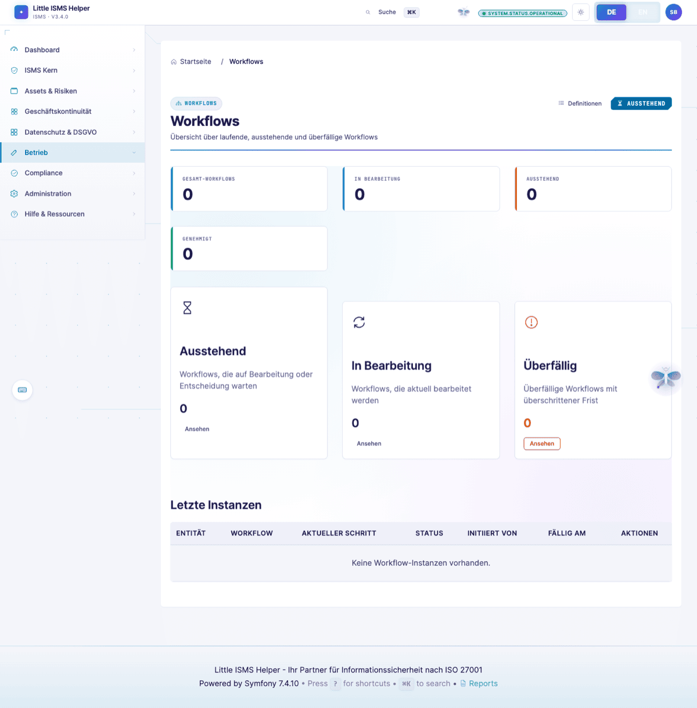

# Workflow Auto-Progression

> User-facing workflow inbox view (Risk-Owner perspective): [Sichtwechsel — Risk-Owner](sichtwechsel/risk-owner-business.md)

Two mechanisms move work forward without an explicit click. They are separate:

| Mechanism | Moves | Configured in | Runs |
|---|---|---|---|
| Lifecycle auto-transition | the record's own status (e.g. data breach `draft` → `under_assessment`) | `config/packages/lifecycle.yaml` (`lifecycle.auto_transition_rules`) | Doctrine `postUpdate`, `FieldCompletionAutoTransition` |
| Time-based step approval | a step of a regulatory approval chain (`WorkflowInstance`) | step metadata `autoProgressConditions.type: time_based` | `app:process-timed-workflows`, scheduler every 15 min |

Changes the tool derives itself (residual risk, protection need, effectiveness, risk from a CVE, …) are
not written automatically; they are proposed in the suggestion queue and applied after a person accepts —
see [SUGGESTION_QUEUE.md](features/SUGGESTION_QUEUE.md).



## 1. Lifecycle auto-transitions (`FieldCompletionAutoTransition`)

`src/Lifecycle/EventListener/FieldCompletionAutoTransition.php` reads the rules per entity class and,
after an entity is saved, applies the named lifecycle transition through `LifecycleService` when the rule
holds:

```yaml
# config/packages/lifecycle.yaml
lifecycle.auto_transition_rules:
    App\Entity\DataBreach:
        assess_when_complete:
            workflow: data_breach_lifecycle
            transition: assess
            required_fields: [severity, affectedDataSubjects, dataCategories]   # all non-empty
        assess_high_severity:
            workflow: data_breach_lifecycle
            transition: assess
            conditions:
                all:                                    # AND; `any:` = OR
                    - { field: severity, comparison: ">=", value: high }
                    - { field: affectedDataSubjects, comparison: ">", value: 100 }
```

- Operators: `==`, `!=`, `>`, `<`, `>=`, `<=`; `value_from` reads the right-hand side from another field.
- Rules exist for DataBreach, DPIA, Risk, Incident and ProcessingActivity.
- Best effort: a transition the current status does not allow, or an unknown workflow, is skipped and logged;
  the save is never rolled back.
- The listener acts as an automatic actor: a four-eyes transition (e.g. risk `accept`) is refused by
  `FourEyesValidator` (`automatic_actor`) and stays for a person.

`WorkflowAutoProgressionBridge` closes the loop the other way: when an approval chain for a record reaches
`approved`, it fires the record's lifecycle transition from `lifecycle.approval_bridges` (currently Document →
`document_lifecycle.approve`).

## 2. Regulatory approval chains (`config/workflows/regulatory/*.yaml`)

The YAML files are the source of truth for the approval chains (ADR
`docs/decisions/2026-05-17-workflow-yaml-unification.md`). Per-organisation changes to a step (approver,
days, conditions) are made under **Admin > Workflows** (`/admin/workflows`).

| Workflow | Norm | Module | Steps (approver role) |
|---|---|---|---|
| `gdpr_data_breach` | GDPR Art. 33/34, 72 h SLA | privacy | DPO, CISO, Manager (notification), DPO, DPO, DPO |
| `incident_high_severity` | ISO 27001 5.24–5.28 | — | CISO, BCM officer, ISB, DPO, CISO, Manager |
| `incident_low_severity` | ISO 27001 5.24–5.28 | — | ISB, ISB, Manager, ISB |
| `incident_post_mortem` | ISO 27001 5.24–5.28 | — | CISO ×3 |
| `risk_treatment` | ISO 27001 6.1.3 / ISO 27005 | — | owner, CISO, DPO, Top management, Top management, Auditor |
| `dpia` | GDPR Art. 35/36 | privacy | owner, DPO, CISO, Risk manager, Manager, DPO |
| `dsr` | GDPR Art. 12–22 | privacy | DPO ×5 |
| `capa` | ISO 27001 10.1 | — | Manager, CISO, Manager, Auditor, CISO |
| `change_request` | ISO 27001 A.8.32 / 6.3 | — | CISO, Manager, Manager, CISO |
| `management_review` | ISO 27001 9.3 | — | CISO, Top management, CISO, CISO |
| `control_verification` | ISO 27001 8 / Annex A | — | owner, CISO, Auditor |
| `supplier_assessment` | ISO 27001 A.5.19–22, GDPR Art. 28, DORA Art. 28–30 | — | Manager, DPO, CISO, CISO, Manager |
| `training_verification` | ISO 27001 A.6.3 | — | Manager, Manager |
| `bc_plan_activation` | ISO 22301 | — | Manager, BCM officer, Manager, Manager, CISO |
| `document_review` | ISO 27001 7.5.3 | — | Manager, Manager, CISO |

`owner` is not a role: the step goes to whoever is responsible for the record (`Responsibility::ofRecord()`,
see [DEADLINES_AND_RESPONSIBILITY.md](DEADLINES_AND_RESPONSIBILITY.md#workflow-steps-owned-by-the-record)).
Gate 82 (`check_workflow_roles.py`) requires every `approver_role`, transition `roles` entry and
`escalation_role` to exist in `security.yaml`, and no approval step may be open to `ROLE_USER`.

Steps are approved by people (Mein Tag, workflow page, `decision_modal()`). Steps also carry
`auto_progress_conditions` of type `field_completion`, `auto` or `risk_appetite`; these are kept with the
definition and editable in the overlay, but only `time_based` is evaluated (see below). Data-driven
progression runs on the record's lifecycle (section 1).

`php bin/console app:generate-regulatory-workflows [--workflow=data-breach] [--overwrite]` writes the
definitions as `Workflow` rows; `app:migrate-legacy-workflows` checks that every DB row has a YAML
counterpart (`--archive` archives the rest).

### Time-based steps

```yaml
auto_progress_conditions:
    type: time_based
    delay: "24 hours"      # minutes, hours or days
```

- The delay counts from the moment the step became active (approval of the previous step, or the start).
- The step is approved through `WorkflowService` with the initiator as acting user; the approval history
  records `auto_approved` with `trigger: time_based`.
- **Automatic approvals never satisfy four-eyes.** The cron, `FieldCompletionAutoTransition` and
  `WorkflowAutoProgressionBridge` act as automatic actors (`automatic: true` on
  `LifecycleService::transition()`); `FourEyesValidator` refuses every four-eyes transition for them
  (`automatic_actor`), the single-approver escape included. A time-based step whose approval would close
  the workflow (last step, or only notification steps follow) stays pending. The cron lists such instances
  under "Awaiting human approval" (`four-eyes` or `blocked: <guard message>`), writes nothing and exits 0;
  a lifecycle guard that blocks the close (e.g. module inactive) is treated the same way
  (`AutomaticCloseRefusal`). A transition the current status does not allow is an error.
- The cron pins each instance's organisation in `TenantContext`, so an organisation that turned four-eyes
  off for `approve` gets its time-based close.
- Final approval (four-eyes): whoever may approve the final step (its `approver_role` through the role
  hierarchy, or its `approver_users`) may give it; the transition's own `roles` are not re-checked. The
  initiator cannot be the sole final approver (unless they are the only eligible approver and document the
  offline counter-signature in the comment). If the last step is a notification step, the approver of the
  preceding step grants the final approval.

```bash
php bin/console app:process-timed-workflows --dry-run
```

The same command also retries and ticks the SLA clocks (missed statutory deadlines). The one scheduler cron
line from [HOSTING_WORKER.md](user-guide/HOSTING_WORKER.md) is enough.

## Auto-reactions

Independent of workflows, five listeners create follow-up records; each can be switched off per
organisation under Admin > Einstellungen (category `auto_reactions`, `AutoReactionService`):

| Trigger | Result |
|---|---|
| Processing activity with high-risk indicators and no DPIA | draft DPIA (`AutoReactionDpiaSuggestListener`) |
| New user | assignment of mandatory trainings for the user's roles (`AutoReactionTrainingAssignListener`) |
| Vulnerability with CVSS ≥ 7.0 | risk suggestion in the suggestion queue (`RiskFromVulnerabilityKind`) |
| Audit finding major/critical/high; incident high/critical with root cause | corrective action, due in 30 days (`AutoReactionCorrectiveActionListener`, `AutoReactionCorrectiveActionListenerForIncident`) |
| Document approved with "requires acknowledgement" | pending policy acknowledgement for every active user of the organisation (`AutoReactionAcknowledgementCampaignListener`) |

A corrective action confirmed as ineffective creates a follow-up action
(`AutoReactionRecapaOnIneffectiveListener`).

## Troubleshooting

- **Status does not change after saving:** check the rule in `lifecycle.yaml` (field names, transition
  allowed from the current status) and the log (`var/log/*.log`); a four-eyes transition always waits.
- **Time-based step stays pending:** run `app:process-timed-workflows --dry-run`; "Awaiting human
  approval" is expected for a closing four-eyes step.
- Approval history of an instance: Workflows → instance page (`/workflow/instance/{id}`).
